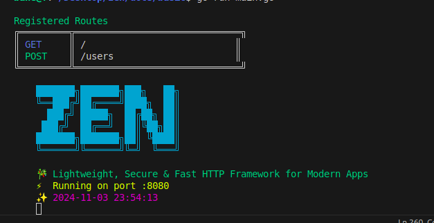

# Zen

Zen is a small, fast HTTP framework for Go. It has a trie-based router, route
groups, composable middleware and a thin request context, with no
dependencies outside the standard library. Optional middleware (CORS, JWT auth,
rate limiting, security headers) lives in a separate package.


<p align="start">
    
</p>

```bash
go get github.com/ThembinkosiThemba/zen
```

## Quick start

```go
package main

import (
	"net/http"

	"github.com/ThembinkosiThemba/zen"
)

func main() {
	app := zen.Default() // includes Logger and Recovery

	app.GET("/", func(c *zen.Context) {
		c.JSON(http.StatusOK, zen.M{"message": "Welcome to Zen!"})
	})

	app.Serve(":8080")
}
```

`zen.New()` returns an engine with no middleware. In `DevMode` (the default)
the registered routes are printed on startup; call
`zen.SetCurrentMode(zen.Production)` to turn that off.

## Routing

```go
app.GET("/users", listUsers)
app.POST("/users", createUser)
app.GET("/users/:id", getUser)            // c.GetParam("id")
app.GET("/static/*filepath", serveFiles)  // c.GetParam("filepath") == "/css/app.css"
app.Handle("PROPFIND", "/dav", davHandler)
```

Static segments take priority over parameters, so `/users/new` and
`/users/:id` can coexist. Trailing slashes are ignored. Registering the same
route twice, or two different parameter names in the same position, panics at
startup.

### Groups and middleware

```go
app := zen.New()
app.Apply(zen.Logger(), zen.Recovery())   // global

api := app.Group("/api", middleware.Auth(secret)) // group middleware
api.GET("/me", me)

admin := api.Group("/admin")
admin.Apply(requireAdmin)
admin.DELETE("/users/:id", audit, deleteUser) // route middleware
```

Middleware is a plain `HandlerFunc`. Call `c.Next()` to run the rest of the
chain, or `c.Quit()` / `c.QuitWithStatus(code)` to stop it:

```go
func requireAdmin(c *zen.Context) {
	claims, ok := middleware.GetClaims[*middleware.BaseClaims](c)
	if !ok || claims.Role != "admin" {
		c.Error(http.StatusForbidden, "admin only")
		c.Quit()
	}
}
```

Middleware applies only to routes registered **after** it is added, so call
`Apply` before defining routes. Global middleware also runs for requests that
match no route. Use `app.NoRoute(...)` to customise the 404 response.

## Context

| Request                         | Response                                |
| ------------------------------- | --------------------------------------- |
| `c.GetParam("id")`              | `c.JSON(code, obj)`                     |
| `c.GetQueryParam("q")`          | `c.Text(code, format, values...)`       |
| `c.GetHeader("User-Agent")`     | `c.Status(code)`                        |
| `c.GetCookie("session")`        | `c.SetHeader(key, value)`               |
| `c.GetClientIP()`               | `c.SetCookie(cookie)`                   |
| `c.ParseJSON(&v)`               | `c.Success(code, data, message)`        |
| `c.ParseJSONWithError(&v)`      | `c.Error(code, message, details...)`    |
| `c.Request` (`*http.Request`)   | `c.Writer` (`http.ResponseWriter`)      |

`c.Set(key, value)` and `c.Get(key)` store values for the lifetime of the
request. `*zen.Context` implements `context.Context`, using the request's
deadline and cancellation, so it can be passed straight to database calls.

`c.Success` and `c.Error` write a standard envelope:

```json
{ "status": 200, "success": true, "data": { "id": 1 }, "message": "done" }
```

### Client IP behind a proxy

`c.GetClientIP()` returns the connection's remote address. Forwarding headers
can be forged by any client, so they are only used for requests coming from a
proxy you trust:

```go
app.SetTrustedProxies("10.0.0.0/8", "127.0.0.1")
```

## Built-in middleware

### Logger

```go
app.Apply(zen.Logger())

// Write to a file as well, and skip noisy paths.
f, _ := os.OpenFile("zen.log", os.O_CREATE|os.O_WRONLY|os.O_APPEND, 0o644)
app.Apply(zen.LoggerWithConfig(zen.LoggerConfig{
	Output:    io.MultiWriter(os.Stdout, f),
	SkipPaths: []string{"/health"},
}))
```

### Recovery

`zen.Recovery()` turns a panic into a `500` response and logs the stack trace.

## Optional middleware

```go
import "github.com/ThembinkosiThemba/zen/middleware"
```

### CORS

```go
app.Apply(middleware.CORS()) // any origin

app.Apply(middleware.CORSWithConfig(middleware.CORSConfig{
	AllowOrigins:     []string{"https://example.com"},
	AllowMethods:     []string{"GET", "POST"},
	AllowHeaders:     []string{"Content-Type", "Authorization"},
	AllowCredentials: true,
	MaxAge:           3600, // seconds
}))
```

Preflight requests are answered with `204` and requests from other origins are
rejected with `403`. Combining `AllowCredentials` with `"*"` panics.

### JWT authentication

```go
api := app.Group("/api", middleware.Auth("your-secret-key"))
api.GET("/me", func(c *zen.Context) {
	claims, _ := middleware.GetClaims[*middleware.BaseClaims](c)
	c.Success(http.StatusOK, claims.UserID, "ok")
})

token, err := middleware.GenerateToken(&middleware.BaseClaims{UserID: "42"}, "your-secret-key")
```

`AuthWithConfig` lets you read the token from a header, query parameter or
cookie (`TokenLookup: "cookie:token"`), plug in your own claims type with
`ClaimsFactory`, and customise the `Unauthorized` response. Only HMAC-signed
tokens (HS256/384/512) are accepted.

### Rate limiting

```go
app.Apply(middleware.RateLimit()) // 100 requests per minute per client IP

api := app.Group("/api", middleware.RateLimitWithConfig(middleware.RateLimitConfig{
	Limit:   20,
	Window:  time.Second,
	KeyFunc: func(c *zen.Context) string { return c.GetHeader("X-API-Key") },
}))
```

Uses an in-memory sliding window, so limits are per process. Rejected
requests get `429` with a `Retry-After` header.

### Security headers

```go
app.Apply(middleware.Secure())
```

Sets `Strict-Transport-Security`, `Content-Security-Policy`,
`X-Frame-Options`, `X-Content-Type-Options` and `Referrer-Policy`. Each one
can be changed or turned off with `SecureWithConfig`.

## Timeouts and graceful shutdown

`Serve` and `ServeTLS` are shortcuts for `http.ListenAndServe`. For timeouts
or graceful shutdown, use the engine as the handler of your own server:

```go
srv := &http.Server{Addr: ":8080", Handler: app, ReadHeaderTimeout: 10 * time.Second}
go srv.ListenAndServe()
// ...
srv.Shutdown(ctx)
```

See [examples/basic](examples/basic/main.go) for a complete program.

## Contributing

```bash
make test   # go test ./...
make race   # with the race detector
make bench  # benchmarks
```

## License

MIT, see [LICENSE](LICENSE).
